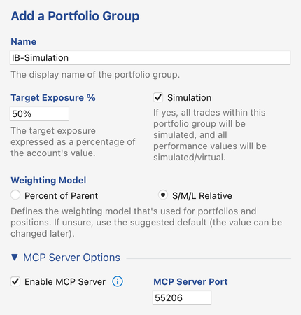
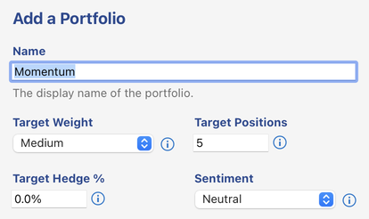
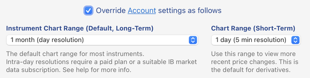
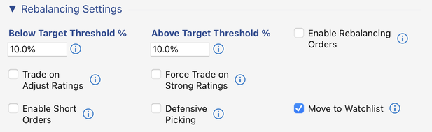
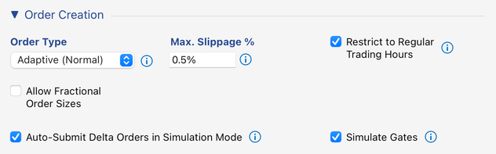
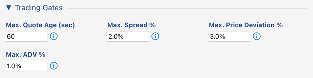
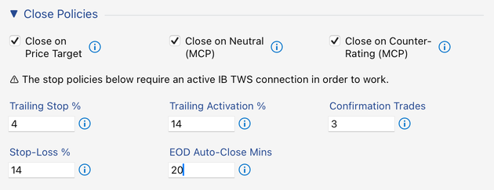
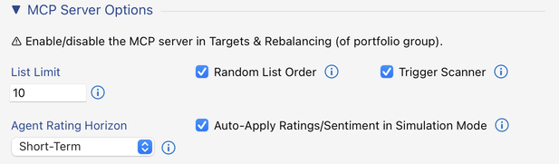
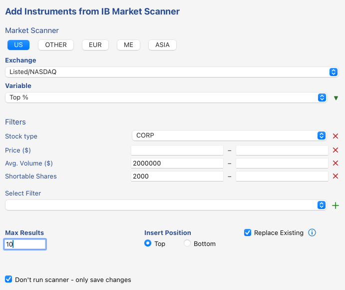

# Simulated Day Trading with `instrument-rating`

> **Disclaimer:** This tutorial and the `instrument-rating` skill are provided only as an example. They must not be used for real
> investment decisions: the ratings and price targets the skill produces are not investment advice.

This tutorial sets up one possible scenario: an AI agent rates the instruments of a portfolio every hour during the trading day, and
InvMon trades on those ratings in a **simulation**. The agent rates, InvMon turns the ratings into delta orders, and the simulation
executes them at current prices. No order ever reaches your broker.

The setup trades **long only**. A Sell rating closes a position, but never opens a short one. *Variation: long and short* at the end
says what to add for that.

## Prerequisites

- InvMon on a paid plan. The MCP server and the settings below need one, and every paid plan includes them.
- Interactive Brokers TWS, running and connected to your IB account. Nothing is sent to IB in this setup, but the candidates come from
  IB market scanners, and the trading gates and close policies act on the live quotes of that connection.
- Claude Code, installed and signed in. Its search makes the ratings current, and it is the agent that InvMon can repeat a run with.
  You don't need to download this repository: InvMon ships the skills and sets the agent up.

## 1. Create the portfolio group

In the Portfolios panel, add a portfolio group for the agent to work in.

- **Simulation** on. Every trade in this group is simulated, several settings below appear only for a simulation group, and it is why
  no order can reach your broker.
- **Enable MCP Server**, in *MCP Server Options*, is optional here: starting the agent from InvMon (step 5) switches it on.

## 2. Add the portfolio

Add one portfolio to the group.

Target Weight *Medium*, 5 target positions, **Target Hedge % 0** (long only) and sentiment *Neutral*. The 5 target positions cap how
many positions the agent's ratings can open at a time.

## 3. Portfolio group settings

Open the portfolio group's *Settings...* dialog (context menu on the group in the Portfolios panel), enable editing, and override the
account settings as follows.

### Chart range

Set **Chart Range (Short-Term)** to **1 day (5 min resolution)**. Together with the Short-Term *Agent Rating Horizon* (see *MCP Server
Options* below), it makes the agent rate every instrument for the move until today's close: a day-trading horizon. The agent then needs
quotes minutes old, and while an instrument's exchange is closed it doesn't rate it at all.

### Rebalancing settings

- **Enable Rebalancing Orders** off: the simulation buys and sells whole positions and doesn't adjust open ones.
- **Trade on Adjust Ratings** off: Buy/adjust is too weak a signal to open a position.
- **Force Trade on Strong Ratings** off. With it on, a Strong Buy opens a position even when all 5 target positions are taken.
- **Enable Short Orders** off: long only.
- **Move to Watchlist** on: a closed position moves to the watchlist instead of the candidates, so the simulation doesn't open it again.

### Order creation

The first two rows are fine at their defaults. The slippage cap matters in a simulation: it sets the estimated execution price, so a
higher value makes the simulation more conservative. The order type doesn't matter for a simulation.

The last row drives the simulation. Both checkboxes appear only for a portfolio group in simulation mode:

- **Auto-Submit Delta Orders in Simulation Mode** on: the group's delta orders are executed as soon as they're created, at the current
  bid or ask and within the slippage cap. Without it, you'd submit every batch by hand.
- **Simulate Gates** on: the trading gates below are applied when a delta order is created, so the simulation trades only when a live
  order would have been executed too.

> A failing gate is recorded on its instrument. An instrument whose gates keep failing can't be traded in time under the current
> market conditions, and the market scanner replaces it first.

### Trading gates

The conditions an order has to meet: a fresh quote, a tight enough spread, a limited deviation of the limit price from the mid price,
and a cap on the order's share of the average daily volume. *Simulate Gates* above applies them.

### Close policies

These policies close positions on their own:

- **Close on Neutral** and **Close on Counter-Rating** (both marked *MCP*): the agent closes a position by rating it Neutral, or with
  any sell rating, Sell/adjust included.
- **Close on Price Target**: a position closes once it reaches the price target the agent submitted with its rating.
- **EOD Auto-Close** 20 minutes: what is still open is closed 20 minutes before the session ends. This setup trades within the day.

The stop policies (*Trailing Stop*, *Stop-Loss* and their *Confirmation Trades*) and *EOD Auto-Close* act on live trade prices, so they
need the TWS connection.

### MCP server options

- **Agent Rating Horizon** *Short-Term*: with the chart range above, the agent rates for today's close.
- **Auto-Apply Ratings/Sentiment in Simulation Mode** on: the setting this scenario turns on. Without it, the agent's ratings are only
  recorded on the instruments for you to review. With it, they become the instruments' own ratings, which drive the target weights and
  the rebalancing, and the price targets become the instruments' own, which *Close on Price Target* acts on.
- **List Limit** 10: at most 10 candidates per listing, which keeps the agent's research within bounds. The positions are always
  listed in full.
- **Trigger Scanner** on: every listing runs the portfolio's market scanner first (step 4), so that the agent rates fresh candidates.
- **Random List Order** on: shuffles the list, which may lower rating bias.

## 4. Configure the market scanner

The portfolio's candidates come from an IB market scanner: *Add from Market Scanner...* in the portfolio's Candidates panel.

<!-- Screenshot to retake (optional): without the Shortable Shares filter. -->

US *Listed/NASDAQ* corporate stocks by **Top %**, sorted descending (the day's top gainers; the arrow next to *Variable*), limited to
liquid names (*Avg. Volume* at least 2,000,000) and to 10 results. **Replace Existing** makes the candidates rotate instead of piling up.

**Don't run scanner – only save changes** saves the configuration without running it. The MCP server runs it whenever the agent lists
the instruments (*Trigger Scanner*).

## 5. Run the agent

With TWS connected, right-click the portfolio group in the Portfolios panel and choose **AI Agent > instrument-rating**. The *Run AI
Agent* dialog opens with the skill set up for a repeated run:

- **Repeat** every **1h**. Shorten the interval for a closer watch; every run costs agent usage.
- **Agent** Claude Code.
- **Instructions** empty: the agent rates the positions and candidates of every portfolio in the group.
- **Switch on the MCP Server**, shown while the group's server is off, stays checked.

The line below *Skill* shows the rating horizon the agent rates for. Click **OK**: a terminal window opens, and Claude Code starts the
run and repeats it every hour as long as the window stays open.

Every hour, the agent lists the positions and candidates (the scanner refreshes the candidates first), checks the price history and
the news of each, and submits a rating with a note, and often a price target, for each. With *Auto-Apply* on, the ratings take effect at
once: a Buy or Strong Buy on a candidate opens a position if one of the 5 is free, and a Neutral or a sell rating closes one through
the close policies. After the close, the agent says there's nothing left to rate and ends the repetition.

Each instrument's note says what the agent based its rating on, so you can follow the agent's reasoning in InvMon after the terminal is
closed. The run and every change it made are listed in the Action Log. To stop a run before the close, choose *Stop Run...* on its
entry there.

**Starting the agent by hand.** You can also run the skill from a copy of this repository, as described in the
[README](../../README.md#agent-set-up): start Claude Code in it and type `/loop 1h /instrument-rating repeating every 1h`. The MCP server
must then be on, at the port the agent's config expects.

## Variation: long and short

To let Sell ratings open short positions, add a second portfolio with a high *Target Hedge %* (e.g. 80) and its own market scanner,
sorted ascending (the day's top losers) and limited to names with shortable shares, and switch on *Enable Short Orders* in the group
settings. *Defensive Picking* then keeps the simulation from opening shorts while the portfolio's sentiment is *Very Bullish*, and longs
while it is *Very Bearish*; the `market-sentiment` skill, repeated hourly, keeps the sentiment current.

> Short sales are hard to execute in practice because of margin requirements, and their potential loss is unlimited.
