# Rating-Loop Agent — Simulated Trading Set-Up

> **Disclaimer:** This tutorial and the `rating-loop` skill it describes are provided only as an example. They must not be used for real investment decisions — the ratings and price targets the skill produces are not investment advice.

This tutorial explains a possible scenario for using the rating-loop skill.

The `rating-loop` skill lets Claude research the instruments of an InvMon portfolio group and submit a rating (optionally with a price target) for each one via InvMon's built-in MCP server. 

When run in a loop, together with a suitable InvMon configuration, this skill can drive a simulated trading scenario end to end: the agent rates, InvMon turns the ratings into delta orders, and the simulation executes them at current prices. The setup below explains the necessary configuration for an automated, simulated day-trading scenario.

> This setup provides one possible scenario. **Note that Sell ratings result in simulated short-sales which, due to margin requirements, may be difficult to execute in real-life scenarios and come with potentially unlimited risk**. 


## Prerequisites

- InvMon running on a paid plan — the MCP server and the portfolio settings below need one.
- Interactive Brokers TWS running and connected to your IB account. Nothing is ever sent to IB in this setup, but the live quotes from that connection are what the close policies and trading gates act on, and the candidate scanners are IB market scanners.
- Claude Code with this repository (`InvMon.agent`) as the working directory. The bundled `.mcp.json` expects the MCP server on port `55206` — keep the port below in sync, or adjust `.mcp.json`.

## 1. Create the portfolio group

Create a new portfolio group for the agent to work in.

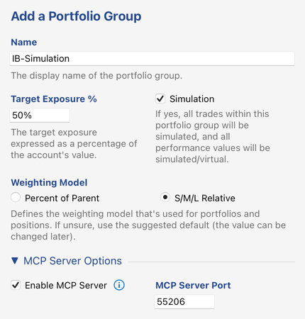

Options worth noting:

- **Simulation** — all trades in this group are simulated. Leave this on: it is what makes the rest of this setup available without a live-trading plan, and it is why no order can ever reach your broker.
- **Enable MCP Server** on port `55206` — this is the server the agent connects to (must match `.mcp.json`).

What makes the agent's ratings actually *do* something — drive target weights, open and close positions — is a portfolio setting, **Auto-Apply Ratings/Sentiment in Simulation Mode**, configured in step 3.

## 2. Add the portfolios

Add two portfolios to the group: a long side and a short side.

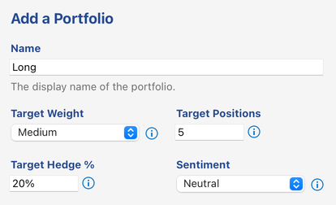

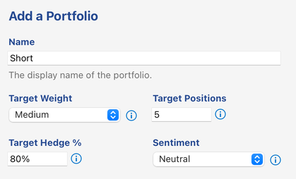

The two are identical (Target Weight *Medium*, 5 target positions, sentiment *Neutral*) except for **Target Hedge %**: 20 for `Long`, 80 for `Short` — so one trades predominantly long, the other predominantly short.

## 3. Portfolio group settings

Open the portfolio group's *Settings…* dialog (context menu on the group in the Portfolios panel), enable editing, and override the account settings as follows.

### Instrument chart range

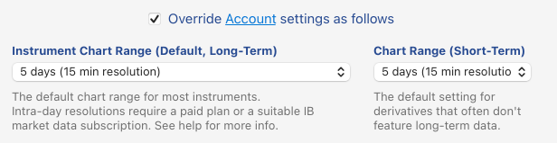

Setting the Default Chart Range (left) to **5 days (15 min resolution)** gives the agent intra-day price bars: `get_price_history` defaults to this range, and short periods return quotes that are only minutes old — the freshness the skill requires before rating an instrument. 

### Rebalancing settings

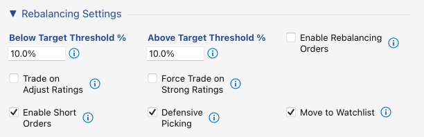

**Enable Short Orders** is required for the `Short` portfolio to work. **Move to Watchlist** will move closed instruments to the watchlist (instead of the candidates list). As a consequence, a once-closed position of an instrument will not be re-opened.

**Defensive Picking** is on (it is off by default). It only bites at the sentiment extremes — no short can be opened while the portfolio sentiment is *Very Bullish*, no long while it is *Very Bearish* — so at the *Neutral* sentiment from step 2 it changes nothing. It becomes relevant if you also run `sentiment-loop` against this group, which is what moves the sentiment.

**Enable Rebalancing Orders** is off - we only buy and sell full positions; we don't rebalance/adjust open positions. **Trade on Adjust Ratings** is off. Buy/adjust is too weak a signal (or so we assume). **Force Trade on Strong Ratings** must be off. If it were on, InvMon would trade any Strong Buy or Strong Sell rating, even if all portfolio target slots are already filled. 


### Order creation

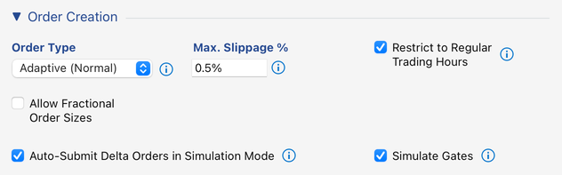

The first two rows are fine at their defaults: adaptive orders, a 0.5% slippage cap, trading restricted to regular trading hours, and no fractional order sizes. Slippage is relevant for simulation mode (it is used to calculate the estimated trade price — adjust it to make the simulation more or less conservative about the execution prices it assumes). The order type itself is not relevant for simulations.

The last row is what drives the simulation; both checkboxes appear only for a portfolio group in simulation mode:

- **Auto-Submit Delta Orders in Simulation Mode** is on: the group's delta orders are executed as soon as they are created, at the current bid/ask price and honoring the slippage above. Without it you would have to submit each batch by hand, which defeats the point of a loop.
- **Simulate Gates** is on: the trading gates from the next section are applied when a delta order is *created*, so the simulation only trades under conditions in which a live order would actually have been executed. A live account applies those gates when it transmits an order; a simulation transmits nothing, so this is what stands in for that.

> Failing gates are recorded on their respective instrument. Instruments with continuously failing gates are basically untradable (in a timely fashion) under current market conditions. Consecutive runs of the market scanner will recycle those first.

### Trading gates

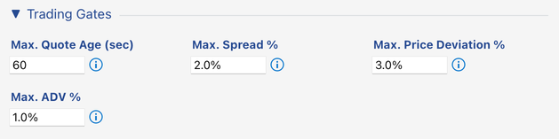

These four thresholds are the market conditions an order has to meet: a fresh quote, a tight enough spread, a limited deviation of the computed limit price from the mid price, and a cap on the order's share of average daily volume. They are thresholds only — *Simulate Gates* above is what applies them here.

### Close policies

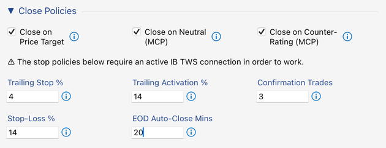

These policies close positions automatically. The two **(MCP)** policies are what let the agent close what it opened: **Close on Neutral** and **Close on Counter-Rating** close a position when the agent downgrades it to Neutral or rates it against the position's direction. **Close on Price Target** closes a position once it reaches the price target the agent submitted with its rating. **EOD Auto-Close** flattens remaining positions 20 minutes before the session ends — this setup is intra-day.

The stop policies (**Trailing Stop**, **Stop-Loss**, and the shared **Confirmation Trades**) and **EOD Auto-Close** are evaluated on live trade prints, so they need the TWS connection from the prerequisites. They are offered here because the group runs in simulation mode.

### MCP server options

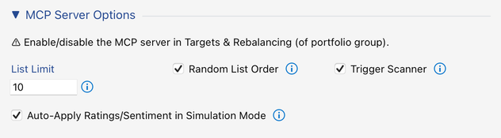

- **Auto-Apply Ratings/Sentiment in Simulation Mode** — the setting this whole scenario turns on. Without it, a rating the agent submits is only *recorded* as an analyst rating: you would see it on the instrument, and nothing else would happen. With it on, the rating is written through to the instrument's own rating, which is what drives target weights and rebalancing, and a submitted price target is written through to the instrument's price target, which *Close on Price Target* acts on. The same applies to a sentiment submitted with `set_sentiment`.
- **List Limit 10** — caps how many instruments `list_instruments` returns per call, keeping the agent's research fan-out bounded. Called without a pool, as this agent does, `list_instruments` returns all of the portfolio's positions plus up to this number of candidates.
- **Trigger Scanner** — a `list_instruments` call triggers the portfolios' saved market scanners first, so the agent always rates a fresh candidate set (see next step).
- **Random List Order** — shuffles the returned list, a minor feature, potentially lowering rating bias.

## 4. Configure the market scanners

Each portfolio gets an IB market scanner that supplies its candidates: *Add from Market Scanner…* on the portfolio.

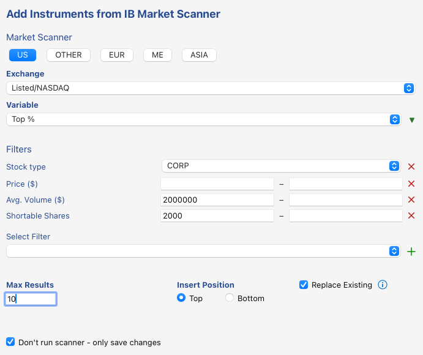

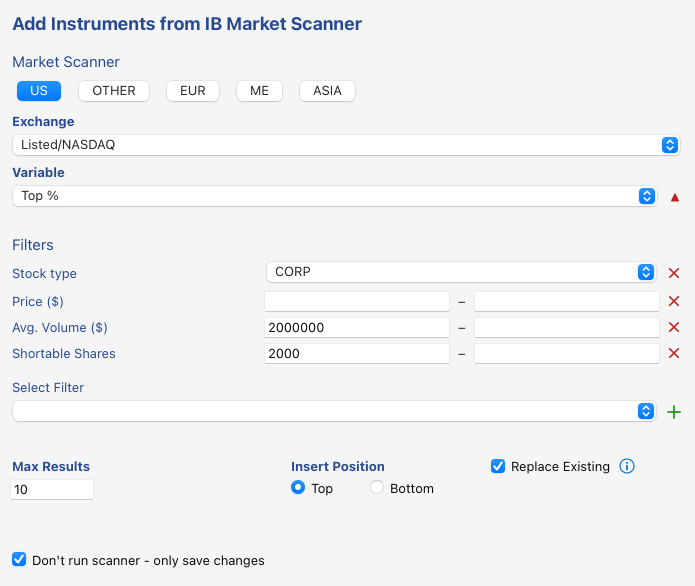

Both scan US *Listed/NASDAQ* corporate stocks by **Top %**, filtered to liquid names (average volume ≥ 2,000,000) that are shortable (shortable shares ≥ 2000), capped at 10 results with **Replace Existing** so the candidate pool rotates instead of growing. The only difference is the sort direction (the arrow next to *Variable*): descending for `Long` (top gainers), ascending for `Short` (top losers).

**Don't run scanner – only save changes** stores the configuration without running it — the scans are executed later by the MCP server (via *Trigger Scanner*) whenever the agent lists instruments.

## 5. Run the agent

With TWS connected and InvMon running:

```
cd InvMon.agent
claude
```

Then run the skill once:

```
/rating-loop
```

or in a loop during market hours:

```
/loop 1h /rating-loop
```

The agent lists the instruments, pulls price history, researches each name, submits ratings via `update_ratings`, and prints a summary. Ratings, notes, and price targets are visible in InvMon and — with *Auto-Apply Ratings/Sentiment in Simulation Mode* on — drive the simulated trading: new positions through the rebalancer, and closes through the policies above.

<!-- Editorial note: possible extensions — a screenshot of the InvMon UI after a run (ratings/notes visible on the instruments), a sample agent console summary, and a short troubleshooting section (MCP port mismatch, missing IB market data subscription). -->
